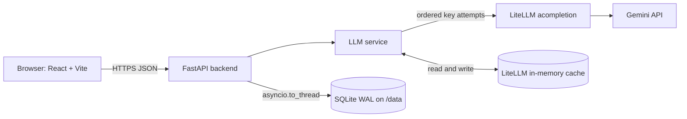
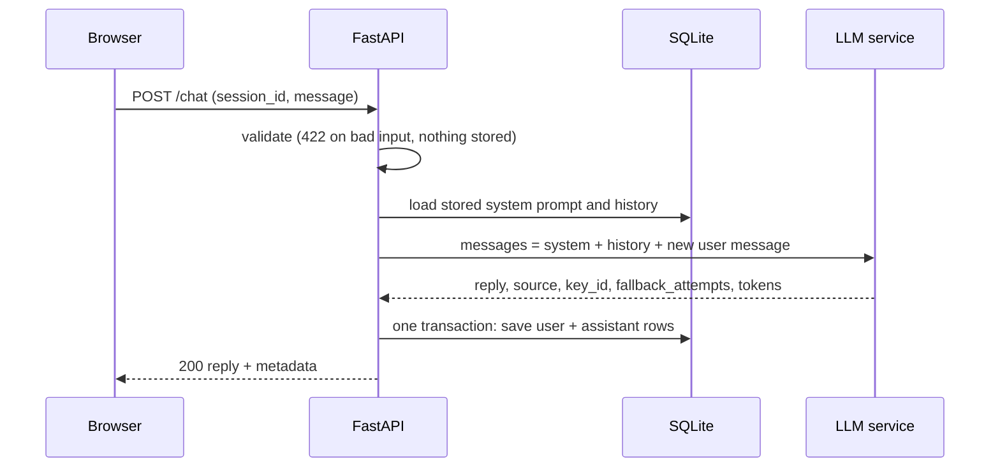
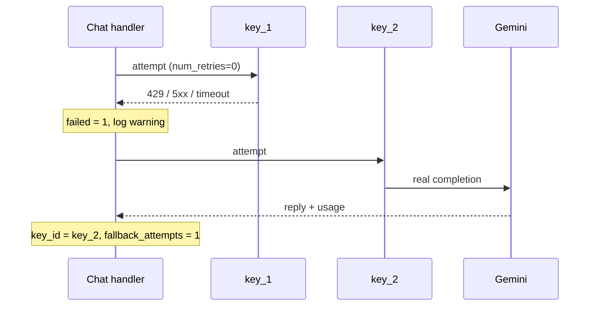

# LLM Chatbot with Key Failover and Response Caching

A full-stack chat app: a FastAPI backend that calls an LLM through LiteLLM with **ordered API-key failover** and **LiteLLM's built-in response cache**, stores multi-turn history in **SQLite**, and a React console that shows exactly how every reply was produced (cache or live, which key, latency, token use).

## 1. Live URLs

|  | URL |
| --- | --- |
| Frontend | https://lyftr-chatbot.vercel.app |
| Backend | https://lyftr-backend-y8gk.onrender.com |
| Health check | https://lyftr-backend-y8gk.onrender.com/health |
| Repository | https://github.com/Saransh-Saluja/lyftr-chatbot |

> **Free-tier note.** The backend runs on Render's free plan: it sleeps after \~15 minutes without traffic (the first request after that can take about a minute) and its disk is ephemeral, so **stored history and the in-memory cache reset when the instance restarts or sleeps**. Locally, with Docker, the SQLite file lives on a named volume and survives restarts (verified, see section 4).

## 2. Run locally: with Docker and without

### With Docker (what `make up` does)

```bash
cp .env.example .env          # then put two real keys in LLM_API_KEYS=key1,key2
make up                       # backend http://localhost:8000, frontend http://localhost:3000
make smoke                    # black-box contract check against the running stack
make test                     # backend tests inside Docker
make logs                     # follow logs
make down                     # stop (the data volume is kept)
make clean                    # stop AND delete the data volume and images
```

### Without Docker

Backend (Python 3.12):

```bash
cd backend
python3.12 -m venv .venv && source .venv/bin/activate
pip install -r requirements.txt -r requirements-dev.txt
export LLM_API_KEYS=key1,key2 LLM_MODEL=gemini/gemini-3.5-flash-lite \
       DATABASE_URL=sqlite:///./data/app.db ENABLE_FAILURE_SIMULATION=true \
       ALLOWED_ORIGINS=http://localhost:5173
uvicorn app.main:app --port 8000
pytest -q                     # tests (no real API key needed)
```

Frontend (Node 22):

```bash
cd frontend
npm install
VITE_API_BASE_URL=http://localhost:8000 npm run dev    # http://localhost:5173
npm test                      # frontend tests
```

### Environment variables

| Variable | Meaning | Example / default |
| --- | --- | --- |
| `LLM_API_KEYS` | Comma-separated key pool, at least 2. Ids are `key_1`, `key_2`, ... in order | `key1,key2` |
| `LLM_MODEL` | LiteLLM model name | `gemini/gemini-3.5-flash-lite` |
| `LLM_API_BASE` | Optional custom OpenAI-compatible endpoint (used for offline tests) | empty |
| `DATABASE_URL` | SQLite location | `sqlite:////data/app.db` |
| `ALLOWED_ORIGINS` | Comma-separated CORS origins (exact, no trailing slash needed) | `https://lyftr-chatbot.vercel.app,http://localhost:3000` |
| `ENABLE_FAILURE_SIMULATION` | `true` enables the `X-Simulate-Failure` hook; otherwise the header is ignored | `true` |
| `DEFAULT_SYSTEM_PROMPT` | System prompt when a session has none | `You are a helpful, concise assistant.` |
| `LLM_TIMEOUT_SECONDS` | Per-attempt provider timeout | `30` |
| `CACHE_TTL_SECONDS` | Cache entry lifetime | `3600` |
| `PORT` | Port to listen on (set by the host; default 8000) | `8000` |
| `VITE_API_BASE_URL` | **Frontend, build time.** Backend URL the browser calls | `http://localhost:8000` |

Real keys live only in `.env` (git-ignored) or the host's secret settings, never in the repo.

## 3. Design decisions: key fallback, caching, SQLite session storage

### Architecture



### Request lifecycle (`POST /chat`)



If the LLM service raises, the handler returns the error **before** the save step, so failed requests never enter history.

### Key fallback

- **Explicit ordered loop** in `backend/app/services/llm.py` instead of a gateway router. The contract needs `key_id` (who answered) and `fallback_attempts` (how many keys failed first); a router hides per-attempt outcomes, so we own the loop and use LiteLLM for the provider call, exception normalisation, usage and the cache. Each call passes `num_retries=0` so LiteLLM never retries behind our back.
- Order is deterministic: `key_1`, then `key_2`, and so on.
- Failover triggers: HTTP 429 / quota exhaustion, 500, 502, 503, timeouts, connection errors, and invalid/revoked key errors (401/403).
- A provider error another key cannot fix (e.g. a 400 bad request) returns **502** instead of burning every key.
- If every key fails: **HTTP 503** `{"detail":"all providers unavailable"}`, and nothing is saved.
- `X-Simulate-Failure` (only when `ENABLE_FAILURE_SIMULATION=true`) raises the **same LiteLLM exception classes** a real failure raises, so simulated and real failures go through the same `except` branch. Simulated requests bypass the cache (read and write) so demos are deterministic and cannot pollute normal requests.



### Response caching

- Uses **LiteLLM's built-in cache** (`Cache(type="local")`, in memory, 1 hour TTL).
- Cache identity is LiteLLM's own key over the **model and the full message list** (system prompt + history + current message). It contains no session id, no timestamp and no API key, so the same first message in a different session is a hit, and a different message is a miss.
- A hit is detected from LiteLLM's `_hidden_params["cache_hit"]`, not from timing. On a hit: `resolution_source=LLM_CACHE`, identical reply, the **originally stored token usage**, `key_id=null`, `fallback_attempts=0`.
- Two implementation facts found by testing against the installed LiteLLM (1.110.2): (1) its cache-hit path imports `orjson` and `soundfile`, which are not installed by default, and without them a hit silently becomes a miss, so both are pinned in `requirements.txt`; (2) LiteLLM writes the cache in a background task about 100 ms late, so the service also writes through explicitly after each live call.
- Identical in-flight requests are serialized, so the second one hits the cache instead of paying for a duplicate call.
- **Limitations:** the cache is in memory, so it resets on restart and is per process; entries expire after one hour; a conversation's later turns only hit the cache when the full history is identical.

### SQLite session storage

```sql
CREATE TABLE messages (
  id         INTEGER PRIMARY KEY AUTOINCREMENT,
  session_id TEXT NOT NULL,
  role       TEXT NOT NULL,      -- 'user' or 'assistant'
  content    TEXT NOT NULL,
  metadata   TEXT,               -- JSON string, assistant messages only
  created_at TEXT NOT NULL       -- server time, ISO-8601
);
CREATE INDEX idx_messages_session_id ON messages(session_id, id);
CREATE TABLE sessions (
  session_id    TEXT PRIMARY KEY,
  system_prompt TEXT,            -- kept here, never in messages
  created_at    TEXT NOT NULL
);
```

- Schema is created automatically on startup; WAL mode is on.
- User and assistant rows are written together in **one transaction, only after a successful answer** (`BEGIN IMMEDIATE ... COMMIT`, `ROLLBACK` on error).
- System prompts are stored per session in `sessions`, never in `messages`, and `GET /sessions/{id}/messages` never returns them. Sending a new `system_prompt` replaces the stored one; omitting it keeps the stored one.
- Database calls run in `asyncio.to_thread`, so the event loop is not blocked. Requests for the same session are serialized with a per-session lock so history stays consistent.
- `DATABASE_URL` points to `/data/app.db`, which is a **named Docker volume** (`lyftr_data`) in `docker-compose.yml`. The container runs as a non-root user; a small entrypoint fixes `/data` ownership first, so it also works on platform-mounted disks.

### Token and latency tracking

`input_tokens` and `output_tokens` are the provider-reported usage for that single request (input covers system prompt + history + current message). They are never cumulative. `latency_ms` is measured in the backend with `time.perf_counter()` and returned as an integer.

## 4. Verification: how to see failover, cache hits and per-message token usage

Set `BASE` to the backend (`https://lyftr-backend-y8gk.onrender.com` or `http://localhost:8000`).

```bash
BASE=https://lyftr-backend-y8gk.onrender.com

# Health: {"status":"ok","keys_configured":2,"cache_enabled":true,...}
curl -s $BASE/health

# Normal chat: LIVE_INFERENCE, key_id key_1, per-request tokens in metadata
curl -s -X POST $BASE/chat -H 'content-type: application/json' \
  -d '{"session_id":"demo-a","message":"What is the capital of France?"}'

# Cache hit: same first message, NEW session -> LLM_CACHE, key_id null, fallback_attempts 0,
# identical reply and the original token counts
curl -s -X POST $BASE/chat -H 'content-type: application/json' \
  -d '{"session_id":"demo-b","message":"What is the capital of France?"}'

# First-key failover: key_1 fails with 429, key_2 answers: key_id "key_2", fallback_attempts 1
curl -s -X POST $BASE/chat -H 'content-type: application/json' -H 'X-Simulate-Failure: key_1=429' \
  -d '{"session_id":"demo-c","message":"Say hello in Spanish."}'

# All keys fail: HTTP 503 {"detail":"all providers unavailable"}, nothing saved
curl -s -i -X POST $BASE/chat -H 'content-type: application/json' -H 'X-Simulate-Failure: *=429' \
  -d '{"session_id":"demo-d","message":"This will not be stored."}'

# Validation: whitespace-only message -> HTTP 422 with a JSON "detail"
curl -s -i -X POST $BASE/chat -H 'content-type: application/json' \
  -d '{"session_id":"demo-e","message":"   "}'

# History: chronological user/assistant messages, assistant ones carry metadata, no system prompt
curl -s $BASE/sessions/demo-a/messages

# Unknown session -> 404 {"detail":"session not found"}
curl -s -i $BASE/sessions/does-not-exist/messages
```

In the UI every assistant reply shows its source (a distinct amber **LLM_CACHE** badge or a blue **LIVE_INFERENCE** badge), model, latency, input and output tokens, key id and fallback attempts. The **Diagnostics** panel shows backend health, key count, cache status, the session id, a viewer for the stored history, a **Failover test** that arms `X-Simulate-Failure` for the next message only, and a log of recent requests built from real responses.

### Automated checks

| Check | Command | Last result |
| --- | --- | --- |
| Backend tests (mocked provider, real LiteLLM cache path) | `make test` | 48 passed |
| Contract smoke test (stdlib only) against a running server | `python3 scripts/smoke_test.py BASE_URL --origin FRONTEND_ORIGIN` | 31/31 passed locally in Docker and 31/31 against the deployed backend |
| Frontend tests | `cd frontend && npm test` | 14 passed |

Docker persistence was verified by sending a chat, running `make down && make up`, and reading the history back unchanged. When a smoke run fails only because Gemini returned HTTP 503 (provider overload), re-run it; our own failover and 503 behaviour is then what you are seeing.

## 5. Setup Used

- **Editor:** VS Code
- **AI tools:** Claude (Anthropic) was used as an engineering assistant for requirement analysis, writing and reviewing code and tests, and deployment troubleshooting. All code was run and verified by me: tests, smoke tests and deployments were executed on my machine and on the deployed services.
- **Stack:** Python 3.12, FastAPI, LiteLLM, SQLite; React, TypeScript, Vite, Tailwind CSS, Lucide icons; Docker and Docker Compose; Render (backend) and Vercel (frontend); Gemini API.

## 6. Bonus features 

- **Route trace in every reply** (`key_1 ✕ → key_2 ✓`, or `cache · no provider call`), built only from real response metadata.
- **Diagnostics panel** with live health, stored-history viewer and request log.
- **Failover test panel** that arms `X-Simulate-Failure` for one message and hides itself when the server has simulation off.
- **Independent smoke test** (`scripts/smoke_test.py`, standard library only) covering the whole contract, plus `scripts/e2e_local.sh`.
- **Per-session locking** and **in-flight request de-duplication**, so concurrent requests keep history consistent and do not pay twice for the same answer.
- **Non-root containers** with an entrypoint that fixes volume ownership, health checks, and `PORT` support for hosting platforms.
- **Defensive errors:** every error is JSON with a `detail` field, with no stack traces or provider text leaked.

## Known limitations

- Free Render: ephemeral disk and sleep after inactivity (see section 1). A paid instance with a persistent disk at `/data` removes the history limitation without code changes.
- The cache is in-memory and per process; it is not shared across instances and resets on restart.
- Cached results are keyed on the exact message list; paraphrases do not hit.
- Real provider overloads (HTTP 503) can occur on newer Gemini models. The default model was switched to `gemini-3.5-flash-lite` after `gemini-3.1-flash-lite` returned sustained 503s during deployment.